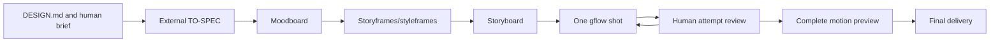

# Co-direct animation

`co-direct-animation` replaces `reference-animation` and owns the full film workflow: authored DESIGN.md plus human briefing → external TO-SPEC → reference direction → five human review packets → reviewed gflow shots → assembled film. The author confirmed the design in the [interview record](gflow-design.md); [ADR 0006](../../.agents/adr/0006-video-model-animation-production.md) records the generation/assembly boundary. [Issue #69](https://github.com/MathBorgess/skills-catalog/issues/69) supplies the acceptance criteria.

| Evidence | Scope |
|---|---|
| Workflow and adapter | Implemented on the branch; not yet published on main |
| Tests | Synthetic record/CLI contracts; source preservation and migration |
| Flow execution | No real image/video generation performed during this implementation |
| Audio | Agent-managed in this iteration; dedicated human exploration tracked in [#70](https://github.com/MathBorgess/skills-catalog/issues/70) |

## Creative responsibility and external context

The [skill](../../skills/creativity/co-direct-animation/SKILL.md) co-directs various animation styles. Apple, Disney, Mindful Movement and the complete attributed LottieFiles compilation remain reference sources, adapted to the work instead of imposing a spatial genre. The source DESIGN.md owns authorship. The external [TO-SPEC](../../skills/creativity/co-direct-animation/references/to-spec-template.md) retains the whole brief, constraints, direction, storyboard, shot IDs, steps, attempts, decisions, changes and next actions beyond model context.

The human chooses the image-generation tool, including gflow or GPT Image. Approved images receive descriptive handoffs and actual input assets accompany video prompts. Flow does not automatically load project Markdown. Audio is delegated to the agent within the accepted brief. Code may assemble generated clips, cut, add static captions/text/marks and finish color; it cannot generate object animation or substitute for a missing video model.

## Review and generation

[workflow.mjs](../../skills/creativity/co-direct-animation/scripts/workflow.mjs) snapshots artifact/spec revisions, preserves human response records and validates dependencies. Each gate needs a decision and criticism, including explicit nothing-to-change. Each visual attempt waits for human review before the next. An accepted clip does not approve an unseen assembled film. Later explicit overrides are scoped and recorded. Scripts validate record consistency, not that a human actually authored a response or that a film is good.

[gflow.mjs](../../skills/creativity/co-direct-animation/scripts/gflow.mjs) submits one clip with literal arguments, snapshots inputs and records stdout/stderr and returned metadata. It checks downloaded output as well as process/JSON status. A catalog is a local CLI interface, not account entitlement; a returned request is not independent server-model or native-video evidence. The adapter does not automatically retry, rewrite prompts or switch providers. Uncertain submissions retain their IDs for recovery; `data download` retrieves the same known operation when the external catalog supports it.

## Migration and validation

The installed name and catalog entry become co-direct-animation; the old workflow is not shipped as a duplicate. The package/plugin version moves to 3.0.0 because the installed name changes. Skill metadata remains the last published 1.0.0 during branch development, per repository policy. Generic link/discovery scripts remove stale links from this checkout; unrelated checkouts are preserved.

New schema 4 runs preserve design and briefing and require video-model provenance and review records. Schemas 1–3 with skill=reference-animation remain readable through compose.mjs under their historical preview contract. That compatibility does not permit new code production; create a new run to resume generation with the new workflow.

The suites test rejection/refinement/resubmission, missing criticism/decision, wrong revisions, dependency invalidation, input snapshots, single-attempt boundaries, uncertain download recovery, absent CLI capability, literal prompt arguments, final packet identity and historical schemas. [The generic walkthrough](walkthrough.md) illustrates the review and blocked-run behavior. Fixture MP4 headers test records only; they are not decoded films or visual evidence. A live generation and full creative/technical inspection remain separate runtime validation.
