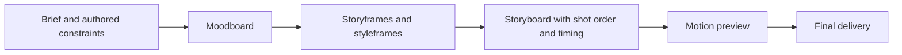

# Co-directing animation through Google Flow

Design investigation for [issue #69](https://github.com/MathBorgess/skills-catalog/issues/69), following [PR #68](https://github.com/MathBorgess/skills-catalog/pull/68). This document records the current evidence and interview. It is maintainer documentation, not an instruction shipped with the skill.

| Item | Status on 2026-10-12 |
|---|---|
| Published skill | `reference-animation` 1.0.0, catalog commit `f98915d0beb860fe1520a490c206a057c75a6edd` |
| Requested production route | Google Flow through the owner's gflow-cli fork; animation generation by a video model |
| Fork inspected | [MathBorgess/gflow-cli](https://github.com/MathBorgess/gflow-cli), `develop`, commit `cdb2f2c6937393103c0a07bc022537dc9f9278cb`; package declares 0.83.2 |
| Evidence collected | Repository metadata, documentation and source inspection |
| Runtime evidence | Fork cloned; gflow was not found on the current shell PATH. No dependency installation, login, image generation or video generation performed |
| Implementation | Implemented on the PR branch after the author confirmed the complete flow; not yet published on main |
| Name and scope | Accepted target: `co-direct-animation`, directing animations of various styles |
| Delivery | Accepted target: assembled film, with agent-managed audio in this iteration |
| Image route | User chooses the available image tool, including gflow or GPT Image; gflow remains the video route |
| Future audio exploration | Requested and recorded in [issue #70](https://github.com/MathBorgess/skills-catalog/issues/70) |
| Generation and iteration | Accepted target: shot-by-shot generation; human review of every visual attempt before the next generation |
| Assembly | Accepted target: cuts, audio, static captions/text/marks and color finishing; no replacement object animation |

## Requirements already stated

- Keep the work's external TO-SPEC as the animation brief and current plan. Preserve source DESIGN.md authorship, source assets, reference attribution, the cast, causal motion score, storyboard, constraints and prior decisions throughout the session.
- Preserve Apple, Disney, Mindful Movement and LottieFiles as reference sources. Documented practice is not proof that a new film will succeed.
- Generate the animation through Google Flow using gflow-cli. Code can manage files, metadata, inspection, archiving and delivery assembly; it cannot substitute a procedurally animated film when generation is unavailable.
- Separate moodboard, storyframes/styleframes, storyboard, motion preview and final delivery into five human creative gates.
- Require both an explicit human decision and explicit criticism for the submitted artifact revision. A human can say there is nothing to change. Silence, a generic continue instruction, technical inspection or an automated score leaves the gate pending. Record later explicit overrides with their precise scope.
- Preserve all authorized retained experiment videos and review assets outside the public catalog. An archive request does not itself authorize uploading private source documents.
- Deliver the assembled film. The agent controls audio within the brief for this iteration, without a dedicated human audio exploration loop; sound remains reviewable as part of the complete film. Dedicated audio exploration is deferred to [issue #70](https://github.com/MathBorgess/skills-catalog/issues/70).
- Rename the skill to `co-direct-animation` and broaden it beyond spatial objects. Mindful Movement and spatial scenes remain available directing references, applied when they support the story rather than as a required genre.
- Let the user select the image-generation tool according to the caller's capabilities, including gflow or GPT Image. Preserve inspected image files and descriptive handoffs regardless of their source.
- Generate shot by shot with the reviewed frames/references when supported. Submit each visual attempt for human review before generating the next one. Do not batch alternative images or clips past that review boundary. Audio remains the expressly delegated exception.
- Permit cuts, audio, static captions/text/marks and color finishing. A material appearance change or replacement generation returns to the affected creative review; finishing cannot become a fallback object animation renderer.

## Problems in the previous published workflow

| Previous location | Gap against issue #69 | Intended change |
|---|---|---|
| [SKILL.md](https://github.com/MathBorgess/skills-catalog/blob/f98915d0beb860fe1520a490c206a057c75a6edd/skills/creativity/reference-animation/SKILL.md), [production workflow](https://github.com/MathBorgess/skills-catalog/blob/f98915d0beb860fe1520a490c206a057c75a6edd/skills/creativity/reference-animation/references/production-workflow.md) | Four packets combine script/moodboard and animatic/styleframes. Generic delegation can advance a gate; criticism is not a separate requirement | Five packets with independent human decision and critique records, exact revisions and dependency tracking |
| Production workflow and [composition/delivery](https://github.com/MathBorgess/skills-catalog/blob/f98915d0beb860fe1520a490c206a057c75a6edd/skills/creativity/reference-animation/references/composition-and-delivery.md) | Renderer proofs, direct renderer alternatives, sampling and render-time estimates describe a code production route | Model generation, observed capabilities, generated shot inspection and measured attempts; no animation renderer fallback |
| [Image handoff](https://github.com/MathBorgess/skills-catalog/blob/f98915d0beb860fe1520a490c206a057c75a6edd/skills/creativity/reference-animation/references/styleframe-handoff.md), [handoff template](https://github.com/MathBorgess/skills-catalog/blob/f98915d0beb860fe1520a490c206a057c75a6edd/skills/creativity/reference-animation/references/styleframe-spec-template.md) | Detailed visual descriptions target a render-writing agent and geometry/material implementation | Retain the description, adapt it to actual image inputs, shot prompts, continuity constraints and video-model observations |
| [TO-SPEC template](https://github.com/MathBorgess/skills-catalog/blob/f98915d0beb860fe1520a490c206a057c75a6edd/skills/creativity/reference-animation/references/to-spec-template.md) | Four gates, no distinct criticism record and no requested-versus-observed generation record | Five gates, review evidence, shot IDs, generation attempts, actual input references/settings and output inspection |
| [compose.mjs](https://github.com/MathBorgess/skills-catalog/blob/f98915d0beb860fe1520a490c206a057c75a6edd/skills/creativity/reference-animation/scripts/compose.mjs) | Provenance/delivery checker does not enforce gate transitions; playable HTML can satisfy the animation record | Preserve legacy provenance reading; add a bounded structural contract for new video-model runs and revision-bound review records |
| [README](https://github.com/MathBorgess/skills-catalog/blob/f98915d0beb860fe1520a490c206a057c75a6edd/README.md) and [delivery documentation](https://github.com/MathBorgess/skills-catalog/blob/f98915d0beb860fe1520a490c206a057c75a6edd/docs/reference-animation/README.md) | Catalog describes four gates, renderer handoffs and code suitability | Rewrite around the agreed co-direction workflow and actual validation evidence |

The previous public repository contained templates and source references, not the filled private TO-SPEC, storyboard or brand outputs from the earlier production session. Preserve the contracts without reconstructing private creative decisions from generic examples.

## What the fork exposes

The following are source-level interfaces, not a claim that these operations were successfully executed on this machine or account. Source links are pinned to the inspected commit.

| Surface | Evidence | Integration consequence |
|---|---|---|
| Image generation and editing | [cli_image.py](https://github.com/MathBorgess/gflow-cli/blob/cdb2f2c6937393103c0a07bc022537dc9f9278cb/src/gflow_cli/cli_image.py) exposes `image t2i` and `image i2i` | User-selected image tool; preserve the same inspected handoff whether images come from gflow or GPT Image |
| Text / frames / references to video | [cli_video.py](https://github.com/MathBorgess/gflow-cli/blob/cdb2f2c6937393103c0a07bc022537dc9f9278cb/src/gflow_cli/cli_video.py) exposes `video t2v`, `video i2v --initial-frame … --end-frame …` and `video r2v --ref …`, with JSON output and local output routing | Choose the input mode from the approved shot, preserve the exact inputs and inspect the generated file |
| Models and duration | [cli_models.py](https://github.com/MathBorgess/gflow-cli/blob/cdb2f2c6937393103c0a07bc022537dc9f9278cb/src/gflow_cli/cli_models.py#L48) builds a pure local catalog; video commands accept 16:9 and 9:16, model-dependent 4/6/8 seconds and Omni 10 seconds | `gflow models --json` describes CLI vocabulary, not account entitlement or proven generation. Do not invent arbitrary clip duration, square output or FPS controls |
| Diagnostic and authentication | [cli_doctor.py](https://github.com/MathBorgess/gflow-cli/blob/cdb2f2c6937393103c0a07bc022537dc9f9278cb/src/gflow_cli/cli_doctor.py), [AGENTS.md](https://github.com/MathBorgess/gflow-cli/blob/cdb2f2c6937393103c0a07bc022537dc9f9278cb/AGENTS.md) | Runtime, saved session and generation capability are distinct evidence. Flow host, account cohort and visible controls can change availability |
| Migrated-host limits | [migrated_composer.py](https://github.com/MathBorgess/gflow-cli/blob/cdb2f2c6937393103c0a07bc022537dc9f9278cb/src/gflow_cli/api/transports/migrated_composer.py#L480) | On the inspected migrated driver, frame inputs must be local files; character entities are refused; R2V is restricted to 8 seconds. These are fork/driver limits, not universal Flow limits |
| Completed-output recovery | [cli_data.py](https://github.com/MathBorgess/gflow-cli/blob/cdb2f2c6937393103c0a07bc022537dc9f9278cb/src/gflow_cli/cli_data.py#L337) exposes `data download` | Recover a known media ID without resubmitting generation, when the active route permits it |
| Multi-scene movie manifest | [cli_movie.py](https://github.com/MathBorgess/gflow-cli/blob/cdb2f2c6937393103c0a07bc022537dc9f9278cb/src/gflow_cli/cli_movie.py), [composition.py](https://github.com/MathBorgess/gflow-cli/blob/cdb2f2c6937393103c0a07bc022537dc9f9278cb/src/gflow_cli/composition.py#L126) | `movie run` generates every scene in its manifest. The inspected scene DTO does not carry initial/end frames or local reference images; generation selects text or character-entity references. It is not a lossless translation of a keyframe-controlled storyboard |
| Movie planning and assembly | [movie command](https://github.com/MathBorgess/gflow-cli/blob/cdb2f2c6937393103c0a07bc022537dc9f9278cb/src/gflow_cli/cli_movie.py#L175), [MOVIE.md](https://github.com/MathBorgess/gflow-cli/blob/cdb2f2c6937393103c0a07bc022537dc9f9278cb/docs/MOVIE.md) | `movie run --dry-run` returns before profile/browser/entity work. `--stitch` hard-concatenates a preview; it does not establish a finished edited film |

The [official Flow model matrix](https://support.google.com/flow/answer/16352836) also distinguishes input modes and duration by model. [Google's creation guidance](https://support.google.com/flow/answer/16353334) describes start/end frames and reusable ingredients, and warns against conflicting image/prompt directions. Product documentation must not be treated as proof that the fork exposes the feature for the active account and host.

## Proposed responsibility boundaries

The author supplies the brief, authored constraints and creative feedback. The skill co-directs: it proposes reference adaptations and distinct concepts, translates the accepted direction into shot packets, inspects results and presents specific criticism and recommendations. Flow generates image/video candidates from the inputs actually submitted. Neither an accepted CLI command nor a generated asset is a human creative decision.

Keep DESIGN.md and TO-SPEC in the project. Translate their relevant content into prompts and attached assets; do not imply that Flow automatically loads either Markdown file. Keep a shot ID across the brief, storyboard, handoff, prompt, attempt and final edit. The external plan remains recoverable when a chat is compacted or a generation fails.

Private records:

- `TO-SPEC.md`: current direction, constraints, shot plan, five review decisions and dependency changes.
- `styleframes/<frame-id>/STYLEFRAME-SPEC.md`: inspected appearance, intended motion, required content/exclusions and exact image revision.
- `attempts/<attempt-id>/`: shot ID and submitted prompt in request.json, input asset hashes/IDs, CLI version/commit, requested model/settings, reported model/settings when available, output IDs/files and inspection evidence.
- Immutable review packets: spec snapshot, artifact list/hashes, dependencies, human decision, human criticism and the evidence for each. Record unavailable values as unknown.

Use individual `video i2v`/`r2v` calls for shots with approved frames or asset requirements. The author chose to review each visual attempt, so an accepted storyboard does not authorize generating a batch without intervening review. Use one candidate per generation attempt; a failed/uncertain submission also requires reporting and a decision before any replacement generation. Retrieval, inspection and repair of local records for the same submitted operation can continue without spending on a new attempt. `movie run` and `video chain` are not the default execution path because they advance through multiple generations without those review boundaries. Do not invoke gflow's own full production skill or an automatic prompt rewriting tool as a substitute for this skill's direction/review contract.

A human `revise` decision with concrete criticism allows the next scoped attempt in the same stage, after updating the prompt/inputs and showing the proposed change. Present that attempt for review again. A single accepted frame/clip does not approve an unseen stage packet. The complete stage still requires its own revision-bound acceptance and criticism; when an attempt is also the complete stage packet, one response can serve both records with that scope stated.

## Proposed five-stage dependency tree

Each submitted creative gate requires a versioned packet, a human decision and human criticism. The initial timed script can remain provisional while moodboard direction is reviewed; the storyboard gate freezes the narrative sequence and shot mapping before dependent motion production. Define storyframes as narrative key poses and styleframes as appearance targets; clarify those terms during the interview before adding them to the shared glossary.

Track actual dependency hashes instead of resetting every decision after any edit. A changed moodboard element invalidates only frames that used it and their descendants. A timing-only storyboard change need not revoke an unchanged styleframe appearance decision. Technical export corruption reopens delivery QA; altered generated pixels require renewed review of the affected creative packet.

The current low-resolution-to-final renderer model cannot simply be relabeled. Regenerating through Flow can alter choreography, geometry and identity. Propose reusing accepted clips for final assembly and using supported upscale/export operations only when appropriate; inspect any changed output. A rerun producing new content is a new creative revision, not a guaranteed quality upgrade.

## Failure and recovery questions

- Discover the executable/version and local command surface before any generation. Then distinguish saved session, account controls and observed generation evidence. Missing capability leaves the current creative gate open with its prepared packet and a specific blocker.
- Separate a provider rejection, a pre-submit configuration error and a submitted operation whose completion/download is uncertain. Recover the operation/output before resubmitting an uncertain attempt; do not assume a failed CLI process means that no generation occurred.
- Record one deliberate experiment question per variant. Numeric spending ceilings are per-work choices; human review of every visual attempt is the default, so no automatic generation-retry envelope overrides it.
- Preserve native generated timing and dimensions as observations. Any cut, reframing, conversion or audio assembly must be explicit in the delivery plan and checked against the accepted narrative.
- If the model changes a protected object or required relationship, report the mismatch and refine within the agreed scope. Do not promise exact logo, typography, physics or character fidelity solely from a reference attachment or seed.

## Recorded decisions and current interview frontier

| Question | Decision or recommendation | State |
|---|---|---|
| Q1 — Finished assembled film or approved clips plus assembly plan? | Assembled film; agent controls audio in the first iteration; create a separate issue for future human audio exploration | Accepted by user on 2026-10-12; issue #70 created |
| Q2 — gflow for images as well as video, or video only? | User chooses the image tool, including gflow or GPT Image, according to availability; video through gflow | Accepted by user on 2026-10-12 |
| Q3 — Rename to `co-direct-animation`, retain `reference-animation`, or use `direct-animation`? | `co-direct-animation` | Accepted by user on 2026-10-12 |
| Q4 — Broad animation direction or spatial objects as the specialty? | Animations of various styles | Accepted by user on 2026-10-12 |
| Q5 — Individual shot calls with reviewed references or movie manifest by default? | Shot-by-shot calls with actual frames/references when supported | Accepted by user on 2026-10-12 |
| Q6 — Agent iteration within a work-specific budget or human review of every attempt? | Review every visual attempt before the next generation; audio remains delegated | Accepted by user on 2026-10-12 |
| Q7 — Permit static captions/text/marks and color finishing, or only cuts/audio? | Permit those finishing operations without recreating object animation; materially changed appearance returns for review | Accepted by user on 2026-10-12 |

The decision frontier is resolved. The author confirmed shared understanding and implementation on 2026-10-12, explicitly assigning the complete flow and external context to co-direct-animation. Model selection, available tools and numeric budgets remain per-work intake choices made against actual capabilities, rather than global invented defaults.

For the accepted rename, update the directory/frontmatter, picker, README and plugin list together. Preserve provenance reading for existing schema 1–3 manifests whose `skill` is `reference-animation`; a new name alone must not make private retained runs unreadable. Bump the package/plugin version for the eventual change under `skills/`; leave the published skill metadata unchanged during this design work.

## Validation contract

- Run `npm run check` and the required package-version check for the PR.
- Exercise meaningful structural cases: approval without criticism, criticism without approval, silence, generic continue, revision mismatch, changed upstream dependencies and a scoped explicit override.
- Provide a generic rejection → refinement → resubmission → acceptance walkthrough, plus a blocked run without a video-generation capability.
- Verify the selected CLI invocation and inspect a real generated/downloaded clip before claiming live integration. Fixture tests prove record handling, not Flow availability, continuity or creative success.
- Reconcile the skill, production workflow, TO-SPEC, descriptive handoffs, README and delivery documentation; remove code-rendered animation fallback from the active production path.

## Confirmed implementation scope

1. Rename the installed operator to `co-direct-animation`, updating catalog, ship list, picker, discovery/tests and active links together. Keep a legacy read path for retained `reference-animation` manifests without shipping a second duplicate workflow.
2. Rewrite the short skill and production references around the five human packets. Preserve authored constraints, reference sources, the external plan, descriptive image handoffs and archive behavior; make spatial direction conditional on the work rather than a genre imposed on every animation.
3. Add a gflow command reference based on the inspected fork and actual installed `--help`; use one image/video attempt at a time. User-selected image tools return inspected assets into the same handoff/shot records. Keep the named model and input mode explicit, and record exposed versions/settings without fabricating unavailable fields.
4. Move repeated procedural work into zero-dependency Node scripts: record and hash review packets, validate decision/criticism fields against the submitted revision, track dependency invalidation and constrain gflow execution to the current permitted shot/attempt. A script can enforce record consistency; it cannot prove that a human authored a response or that the resulting film is good.
5. Preserve known operation IDs and output records across failure. Recover/download a submitted attempt before proposing a replacement. Stop with a concrete prepared packet if executable, session, required model/input controls or generation capability are unavailable.
6. Assemble the accepted generated clips, with agent-managed audio and the permitted static finishing. Reuse accepted content where possible; newly generated content is a new revision. Inspect the complete preview and final export, report actual native/converted specifications, and retain authorized experiments/review assets.
7. Add meaningful record/transition tests and public generic walkthroughs. Run catalog checks and bump package/plugin versions for the eventual skill change; leave skill metadata at its last published version during branch development. Live Flow evidence remains a separate validation task requiring an available runtime and account.
