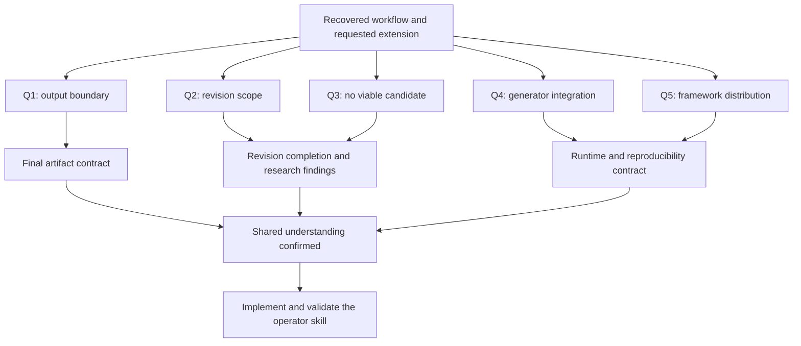

# Morphological project selection: workflow design

| Surface | Status |
| --- | --- |
| Source workflow | Recovered from an executed project exploration |
| Reusable operator skill | Design interview in progress; not implemented or shipped |
| Proponent revision after selection | Requested extension; not performed in the source workflow |
| Commercial result | No observed sales, customer validation or measured competitive advantage |

## Observed sequence

1. Recover the assignment or project brief, constraints, required outputs and unresolved contradictions. Email and academic requirements were input sources in the original case, rather than intrinsic parts of morphological exploration.
2. Normalize the seed ideas into comparable descriptions: purpose, audience, interaction, human control, review/comparison, AI role, proposed difference and smallest useful output.
3. Decompose the ideas into dimensions and alternatives. Preserve the ideas and the box as separate artifacts. Construct representative paths for the original ideas before the later random exploration.
4. Validate dimensions, alternatives and paths. Run the original text-to-morphbox generator, then inspect both the generated PDF and a rendered preview. Structural and visual checks do not establish creative quality.
5. Declare the commercial evaluation criteria before generating the independent candidates. Identify the external commercial-design references and their reuse terms.
6. Draw distinct paths without a semantic or commercial filter. Preserve the seed, box snapshot, source hash, selected indices, alternatives, rejected indices and duplicate paths.
7. Dispatch one separate proponent per accepted path. Each receives the common brief and its own path, without the source ideas or competing proposals. Give each an exclusive output destination. Record requested models and actual concurrency.
8. Preserve the complete prompts and raw candidate proposals, with hashes. Wait for all requested proposals before comparative evaluation.
9. Dispatch a separate devil's advocate. It checks every morphological choice, examines the buyer and reason to pay, challenges costs and acquisition assumptions, evaluates scope and alternatives, and explains the strongest objection to the leading candidate. The original result identified a candidate for paid validation, without establishing that any candidate justified investment.
10. Consolidate the comparison, selection rationale, objections and financial assumptions. Prepare a pitch covering product, audience, interaction, similar products, proposed differences, technologies and feasibility.
11. Investigate the named competitors specifically in There's An AI For That. Earlier proponent and critic research may already have considered competitors; this is a dedicated catalog pass, not the first possible market research.
12. Record the provenance and taxonomy of the catalog evidence. In the source run, access was blocked; the user supplied Supported features. Those labels were preserved without claiming that they were task classifications or directly verified product entries. Official product documentation supported capability comparisons.
13. Refine the pitch and its proposed differences after the competitor investigation. Preserve raw proposals and the critic's report. The source run did not regenerate proposals or perform a second proponent/critic round.

## Procedure invariants recovered from the implementation

- A path selects one existing alternative from every dimension, in dimension order.
- The original draw uses positions 1–4. If a dimension has fewer alternatives, reject an absent position and repeat that dimension, recording every attempt. Do not duplicate a short row to fill the range.
- Reject complete duplicate paths, record the rejection and continue until the requested count is met. Reject a count larger than the box's combinatorial capacity.
- Do not alter a sampled choice to rescue a candidate. A later changed path would be a new, explicitly identified artifact.
- Preserve the seed, random algorithm/version and input snapshot needed to reproduce a run. A port must not silently claim the same seed reproduces a different implementation's sequence.
- Refuse to overwrite an existing run. Preserve original agent outputs; revisions belong in separate artifacts.
- The sampler does not call agents. The orchestrator schedules independent agents within available concurrency, reporting batches accurately when N exceeds the available slots.

## Resolved terminology

The [catalog glossary](../../GLOSSARY.md#morphological-project-selection) distinguishes seed ideas, morphological boxes, morphological paths, project candidates, commercial recommendations and revenue hypotheses. In particular, a path is not itself a project proposal, and a recommendation does not establish observed revenue.

## Design interview

The user requested a reusable operator skill covering N candidates, separate proponents, an independent devil's advocate, suggested adjustments, a revision/consolidation stage, and subsequent competitor research. The following decisions remain open.

| Question | Decision | Recommendation awaiting an answer |
| --- | --- | --- |
| Q1 | Output boundary | Deliver a decision package and pitch; hand off implementation |
| Q2 | Revision scope | One revision by the selected candidate's author, checked by the critic, then consolidated |
| Q3 | No viable candidate | Allow rejection of every candidate; distinguish a research lead from a viable business |
| Q4 | Box integration | Use text-to-morphbox as the principal generator, accepting a compatible existing box |
| Q5 | External framework distribution | Preserve attribution and complete applicable RCD terms if distributing an adaptation; alternatively integrate an external dependency |

Proposed operational defaults are N = 3 and configurable requested proponent/critic models. Separate context and exclusive outputs preserve independence. The number actually simultaneous is limited by the host, rather than by the requested candidate count. No paid services, public repository creation, outreach or product implementation is implied by running this exploration.

The external framework is [Revenue-Centric Design](https://github.com/heliocosta-dev/revenue-centric-design/tree/1942760c2242f609bf63ce2c97204f5a1791bd68), attributed to Richard (@richardrx). Its supplied terms require attribution, preservation of the full terms in copies/derivatives, and prohibit gambling/betting/casino use. Distribution remains Q5; this design note is not a license grant or a publication decision.

## Catalog implementation constraints

Once the interview is complete, follow the repository contract: generic English operator instructions, a concise entrypoint with progressive references, Codex picker metadata, catalog and plugin registration, and Node ESM standard-library helpers. The original Python sampler is behavioral reference material; a future port must record its own reproducibility contract.

Validate executable helpers against meaningful behavior, use independent forward-testing for the multi-agent workflow, and run the catalog's required checks. Structural validation alone cannot prove actual isolation, concurrent execution, commercial demand, competitor superiority or financial return. Package publication and local installation remain separate actions.
